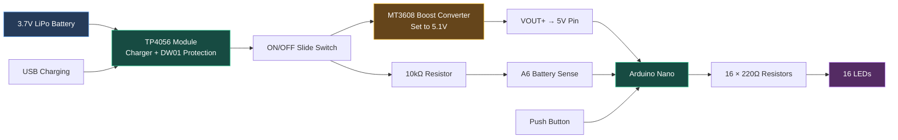

# RGB-LED-Heart_Pattern-Using-Arduino-Nano
❤️ **LED Heart Pattern Using Arduino Nano**  Create a beautiful heart-shaped LED lighting pattern using Arduino Nano. This beginner-friendly electronics project demonstrates LED control, sequential blinking, and creative lighting effects using simple Arduino programming. Perfect for learning electronics and exploring DIY Arduino projects! ⚡
_________________________________________________________________________________
----------------------------------------------------------------
# LED position map (seen from the BACK)

-----------------------------------------------------------------

## 🔌 Circuit Block Diagram

--------------------------------------------------------------------
- The TP4056 charges the LiPo over USB and protects it from over-charge, over-discharge and shorts.
- The slide switch turns everything on and off.
- The MT3608 boosts the battery's 3.0–4.2 V up to a steady ~5.1 V, which goes straight into the Nano's 5V pin.
- Each of the 16 LEDs has its own pin and its own 220 Ω resistor, so every LED can be controlled on its own.
- A 10 kΩ resistor feeds the battery voltage into A6. The code reads it and shuts the LEDs off before the battery gets too low.
- The push button on D2 goes to GND and switches between the light modes.
-----------------------------------------------------------------------
# Nano pinout (seen from the BACK)

-----------------------------------------------------------------------
# Arduino_Nano Wiring with LEDs Positions 

------------------------------------------------------------------------
# Full Circuid Diagram
[heart_led_portable (1).pdf](https://github.com/user-attachments/files/34896030/heart_led_portable.1.pdf)

------------------------------------------------------------------------
# Code
[Uploading LED_Heart_Arduino_Code.ino…]()

